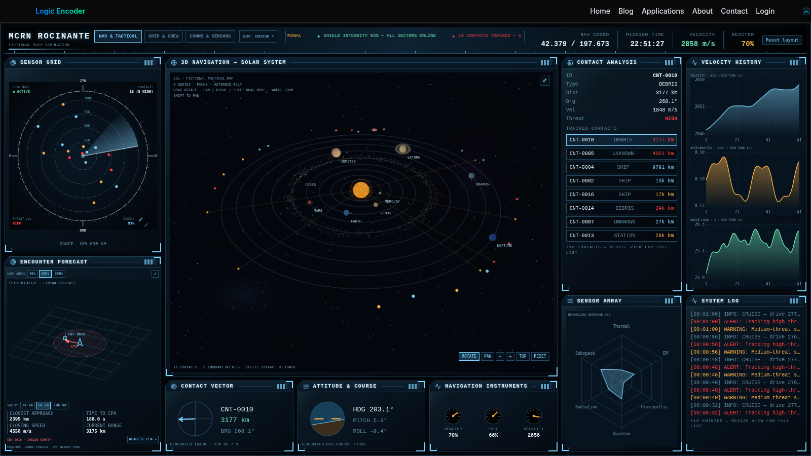

# Rocinante Command Center

Rocinante Command Center is a fictional ship interface you can operate: a command deck for a corvette-class light frigate with three sections, four switchable scenarios, a live-moving contact picture, a 3D solar system and hull schematic, and panels you can resize. Every reading, crew member, contact and radio channel is generated in the browser by a small simulation; nothing on it is a real observation of a real spacecraft. It is built for people who enjoy science-fiction interfaces and want one that behaves like a working one.

## Tech stack

| Layer | Technologies |
|---|---|
| Interface | React 18, JavaScript, HTML and CSS with Tailwind utility classes |
| 3D and charts | Three.js for the solar system, hull, antenna and signal-field scenes; Recharts for the history plots |
| Simulation | A local step simulation that advances velocity, fuel, drive temperature, shield strength and signal interference over time |
| Build | Vite |

## Scenarios

A scenario selector in the header switches the whole ship between four situations: Cruise, High-G Burn, Emergency and Comms Interference. Each one moves the same instruments toward a different target. A burn raises thrust, drive temperature and acceleration together; the emergency scenario shifts power toward defence and cuts the drive; interference raises signal loss, latency and noise on the radio channels. The values ease toward the new targets instead of jumping, and the system log records the change, so the deck reacts as one connected machine.

## Nav and Tactical

The first section is the navigation picture. A sensor grid shows generated contacts that move over time, and selecting one makes it the active contact across the deck. Contact Analysis and Contact Vector describe the selected object, and Attitude and Course with Navigation Instruments show the ship's own heading and motion. Encounter Forecast projects the selected contact's relative path over a horizon of 60, 180 or 300 seconds, draws a safety radius of 2,000, 5,000 or 10,000 km and marks the closest point of approach with its time and distance. The forecast is a straight-line approximation of the simulated motion. A fullscreen solar-system view gives the wider tactical picture.

## Ship and Crew

The second section covers the vessel itself. Propulsion Systems and the Epstein Drive Core show drive state, Power Distribution shows how demand is split, and Shield Grid Status with the Shield Integrity Map tracks the six shield sectors. Crew Vitals and G-Load with its history plot, a Duty Schedule and a Deck Plan cover the people aboard, and Life Support and Weapons Status complete the systems list. A fullscreen Hull Schematic opens the ship model with reactor and drive-temperature callouts.

## Comms and Sensors

The third section holds five radio channels from fleet comms and emergency to deep-space and distress beacon, each with a frequency and a status. Selecting a channel drives the Antenna Array and the signal field, and these 3D views can be dragged, zoomed with the wheel or moved with the arrow keys, and reset. A wideband spectrum analyser and an EM spectrum analysis show the band, Sensor Sweep Log keeps the sweeps, and Advanced Sensors adds diagnostics with a sensor band, a view and a minimum confidence setting that open in fullscreen.

## Arrange the deck

Panels are resizable and the sizes are remembered between visits in the browser. A reset control in the header restores the default layout. Fullscreen buttons expand the solar system, hull, forecast and sensor diagnostics, and on narrower screens the panels stack into a single column. The system log lists timestamped INFO, WARNING and ALERT entries, so a scenario change or a new contact event stays readable after it happens.

Explore [Rocinante Command Center](https://logicencoder.com/rocinante/).

---

Private code: [roci-command-center](https://github.com/logicencoder/roci-command-center)

See [REPOS.md](REPOS.md) for related repositories.

**[Logic Encoder](https://logicencoder.com)** · [GitHub](https://github.com/logicencoder) · [Contact](https://logicencoder.com/contact/)

<!-- TODO(screenshots, 2026-11-07): screenshots from the operator -->
