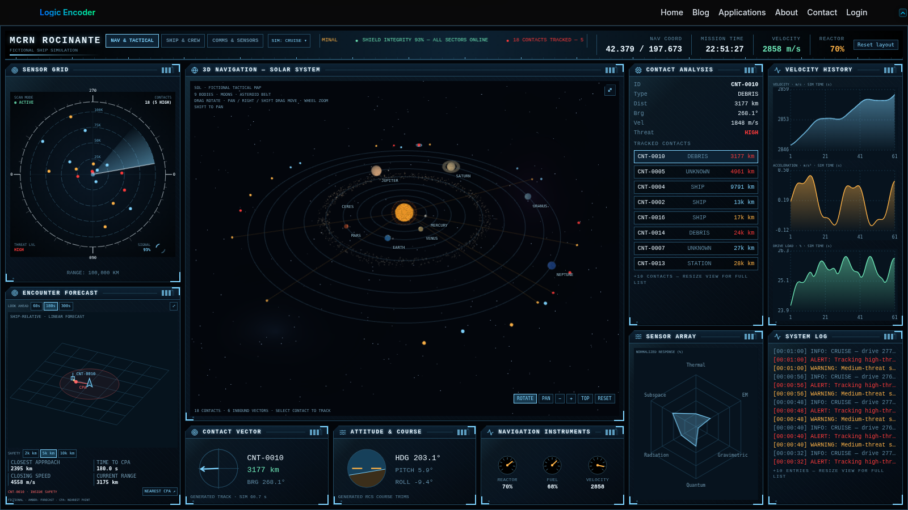

# Rocinante Command Center

Rocinante Command Center turns a fictional ship interface into an interactive entertainment experience. Navigation, ship systems, crew information and communications share a responsive command deck that users can explore and rearrange. All telemetry and contacts are simulated; the experience does not represent real spacecraft monitoring.

## Tech stack

| Layer | Technologies |
|---|---|
| Core stack | React; JavaScript; Three.js; HTML; CSS |

## Explore navigation and tactical views

Navigation and tactical displays offer an animated view of the fictional situation around the ship. Select contacts and inspect the available details, then open the solar view when a wider perspective is useful. The interaction is part of the simulation rather than a source of real-world observations.

The navigation and tactical areas provide different entry points into the command-deck experience. Explore them in relation to the selected situation rather than as isolated decorative panels.

## Inspect ship and crew

Ship and crew areas bring fictional system readings and personnel information into the same command deck. Telemetry charts help communicate change within the scenario. The fullscreen hull view adds an interactive way to explore the ship's presentation.

Ship and crew views make the fictional vessel easier to inspect beyond its exterior. Move between systems and personnel to explore how the command centre presents its world.

## Work with communications and sensors

Radio-channel selection, sensor displays and a spectrum-style analyser create another part of the command experience. The interactive antenna and signal-field view supports dragging, zooming and resetting. These controls let the user explore the simulated equipment instead of only watching a static display.

Communications and sensors add another perspective to the same fictional setting. Keeping these areas within the deck makes exploration feel connected across the available stations.

## Arrange the command deck

Panels can be resized to suit the current focus, with saved layout preferences and a reset option. Fullscreen and navigation-hiding controls make more room for a detailed view. Smaller screens keep the experience readable through vertical navigation.

An adaptable layout lets the viewer give more room to the area currently being explored. The command centre can remain readable as attention moves between its panels.

## Follow a coherent fictional world

Animated readouts, a system log and coordinated views give the interface continuity while it runs. The project combines visual design and interaction around an explicitly fictional setting. Its value is an engaging command-deck experience with controls that invite exploration.

Explore [Rocinante Command Center](https://logicencoder.com/rocinante/).

The product is an interactive fictional workspace. Its coherent presentation is part of the experience; fictional ship information should not be confused with observations from an actual spacecraft.

---

Private code: [roci-command-center](https://github.com/logicencoder/roci-command-center)

See [REPOS.md](REPOS.md) for related repositories.

**[Logic Encoder](https://logicencoder.com)** · [GitHub](https://github.com/logicencoder) · [Contact](https://logicencoder.com/contact/)
